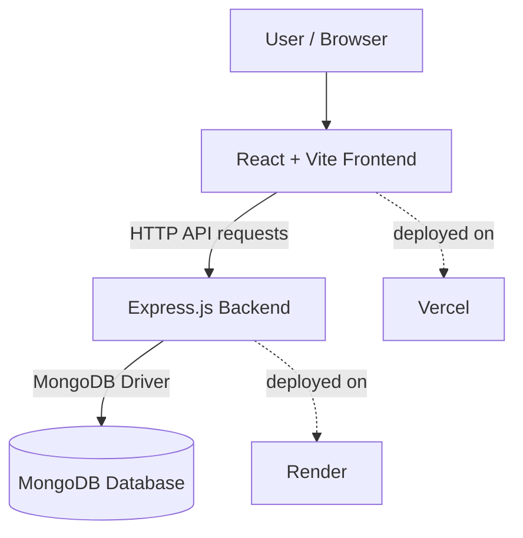

# Notes Application

A full-stack notes management application built with **React, Vite, Express.js, and MongoDB**. 
Users can create, view, search, edit, and delete notes through a simple web interface.

## Features

- Create notes with a title and description.
- View saved notes.
- Search notes by title or description.
- Edit existing notes.
- Delete notes.
- Store notes in MongoDB.
- Deploy the frontend on Vercel and the backend on Render.

## Technology Stack

| Layer | Technology |
|---|---|
| Frontend | React |
| Frontend tooling | Vite |
| Backend | Node.js and Express.js |
| Database | MongoDB |
| Request parsing | Express JSON middleware and Multer |
| Cross-origin requests | CORS |
| Frontend hosting | Vercel |
| Backend hosting | Render |

## Architecture Overview

The frontend sends HTTP requests to the Express API. The backend validates incoming data and reads or 
writes notes in the MongoDB collection named `NotesAppCollection`.



### Request Flow

1. A user performs an action in the React interface.
2. The frontend sends a request to the corresponding Express endpoint.
3. The backend processes the request and communicates with MongoDB.
4. The backend returns a JSON response.
5. The frontend updates the displayed notes.

## Project Structure

The project uses a Vite/React frontend and an Express backend entry file at `config/index.js`. 
The main relevant files are shown below.

```text
notes-application/
├── config/
│   └── index.js          # Express server, API routes, MongoDB connection
├── src/                  # React frontend source and components
├── public/               # Static frontend assets, if present
├── package.json          # Dependencies and npm scripts
├── .env                  # Local environment variables (do not commit)
├── .gitignore
└── README.md
```

## Local Setup

### Prerequisites

Install the following before running the application:

- [Node.js](https://nodejs.org/) — a current LTS version is recommended.
- npm — included with Node.js.
- A MongoDB database, either a local MongoDB server or [MongoDB Atlas](https://www.mongodb.com/).

### 1. Clone the Repository

```bash
git clone https://github.com/Grace422/CodeNova-Internship-Notes-Applications
```

### 2. Install Dependencies

Run this command from the directory containing `package.json`:

```bash
npm install
```

### 3. Configure Environment Variables

Create a `.env` file in the same directory as `package.json` and add:

```env
DATABASE_URL=your_mongodb_connection_string
DATABASE_NAME=your_database_name
PORT=5000
FRONTEND_URL=http://localhost:5173
```

Replace the example values with your actual MongoDB connection string and database name.

For MongoDB Atlas, use the connection string provided by Atlas.

### 4. Start the Backend

Open a terminal in your project root and run:

```bash
npm start
```

The backend uses the `start` script in `package.json` to run `config/index.js`. 
It should connect to MongoDB before starting the server. By default, the local backend uses port `5000`.

If `npm start` reports `Missing script: "start"`, confirm that `package.json` contains:

```json
"start": "node config/index.js"
```

### 5. Start the Frontend

Open a **second terminal** in the same project root and run:

```bash
npm run dev
```

Vite normally serves the frontend at:

```text
http://localhost:5173
```

If Vite prints a different local URL, open the URL shown in the terminal.

### 6. Configure the Frontend API URL

For local development, frontend API requests must target the local backend, for example:

```text
http://localhost:5000/api/notesapp
```

For the deployed application, use your Render backend URL instead. Make sure every operation—fetch, add, search, edit, and delete—uses the appropriate backend URL.

## API Reference

Base path:

```text
/api/notesapp
```

| Method | Endpoint | Purpose |
|---|---|---|
| `GET` | `/getnotes` | Retrieve all notes |
| `POST` | `/addnote` | Create a note |
| `GET` | `/searchnotes?q=<query>` | Search titles and descriptions |
| `PUT` | `/editnote/:id` | Update a note |
| `DELETE` | `/deletenote/:id` | Delete a note |

### Example: Create a Note

**Endpoint:** `POST /api/notesapp/addnote`

Example JSON body:

```json
{
  "title": "Project ideas",
  "description": "Review the next set of features."
}
```

The backend also accepts form submissions handled by Multer on the add-note route.

### Example: Update a Note

**Endpoint:** `PUT /api/notesapp/editnote/:id`

Example JSON body:

```json
{
  "title": "Updated title",
  "description": "Updated description."
}
```

### Example: Search Notes

```text
GET /api/notesapp/searchnotes?q=project
```

The search checks both note titles and descriptions.

## Full-Stack Screenshot

Add a screenshot showing the running Notes Application interface here.

1. Run the application locally or open the deployed Vercel website.
2. Arrange the page so the application title, add-note form, search bar, and note cards are visible.
3. Capture a screenshot of the application. Avoid including browser tabs or sensitive information if possible.
4. Create a folder named `docs/screenshots` in the repository.
5. Save the image as `full-stack.png` inside that folder.
6. Commit and push the screenshot with this README.

## Deployment

### Frontend — Vercel

1. Import the GitHub repository into Vercel.
2. Ensure the project root points to the directory containing the frontend `package.json`.
3. Use `npm run build` as the build command.
4. Set the output directory to `dist`.
5. Ensure the frontend calls the deployed Render API URL rather than `localhost`.

### Backend — Render

1. Create a Render **Web Service** connected to the GitHub repository.
2. Set the **Root Directory** to the directory containing `package.json` and `config/index.js`. Leave it blank if these are at the repository root.
3. Set the build command to `npm install`.
4. Set the start command to `npm start`.
5. Add the environment variables below in Render's Environment settings.

| Variable | Value |
|---|---|
| `DATABASE_URL` | MongoDB connection string |
| `DATABASE_NAME` | MongoDB database name |
| `FRONTEND_URL` | Deployed Vercel origin, if used by the CORS configuration |
| `PORT` | Usually assigned by Render; the server should use `process.env.PORT` |

The backend should listen on `process.env.PORT || 5000` and connect to MongoDB before accepting requests.

## 🌐 Live Deployments

The Notes App is deployed and accessible online.

| Component | Platform | Live Link |
|---|---|---|
| Frontend (React) | Vercel | [Open Notes App](https://code-nova-internship-notes-applicat.vercel.app/) |


